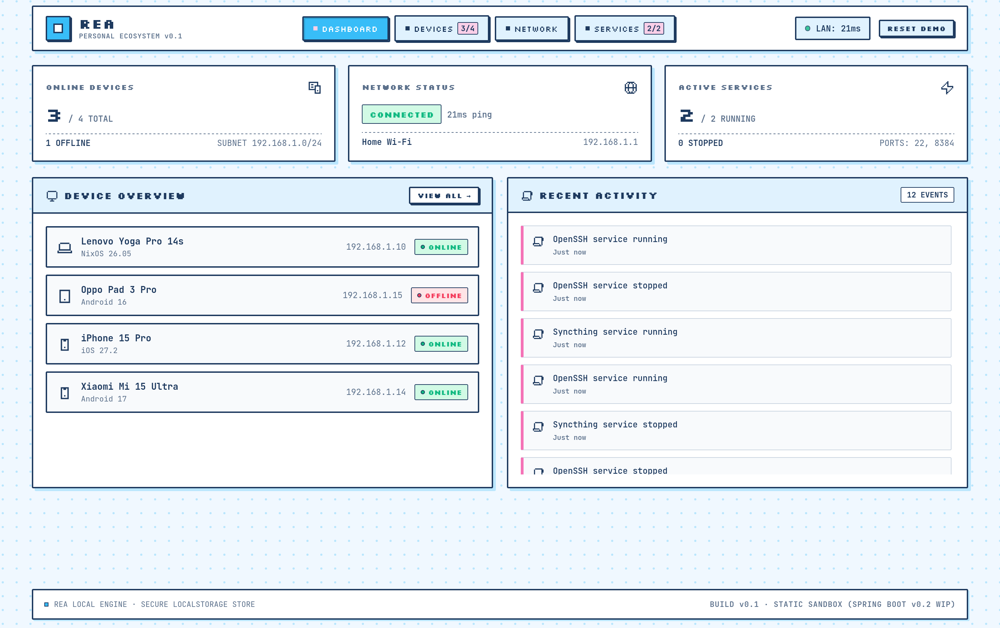
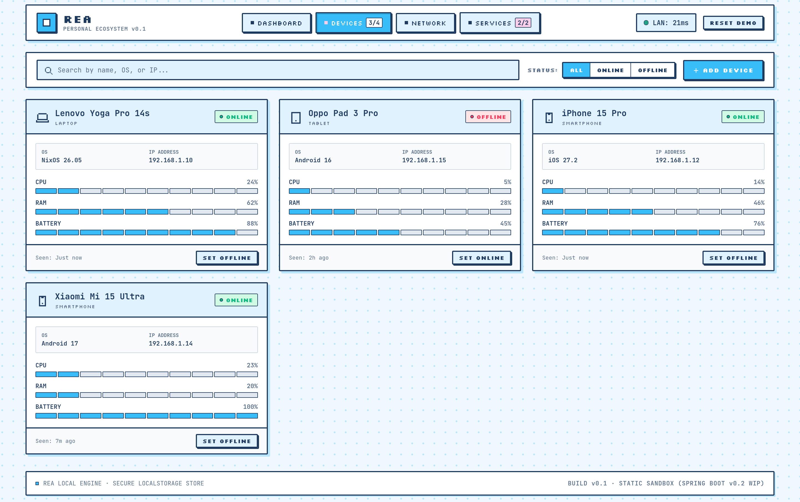
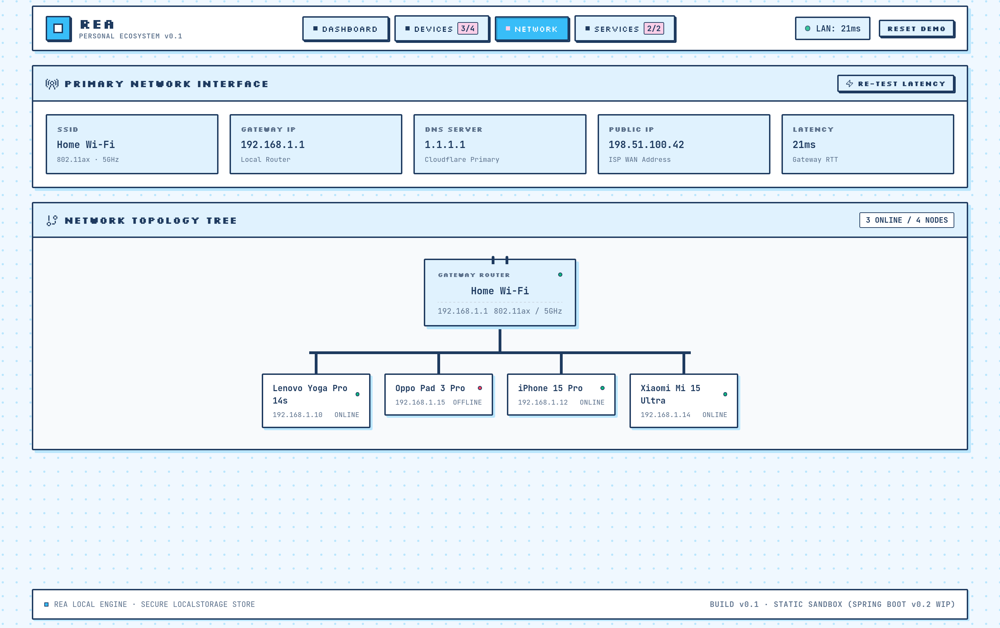
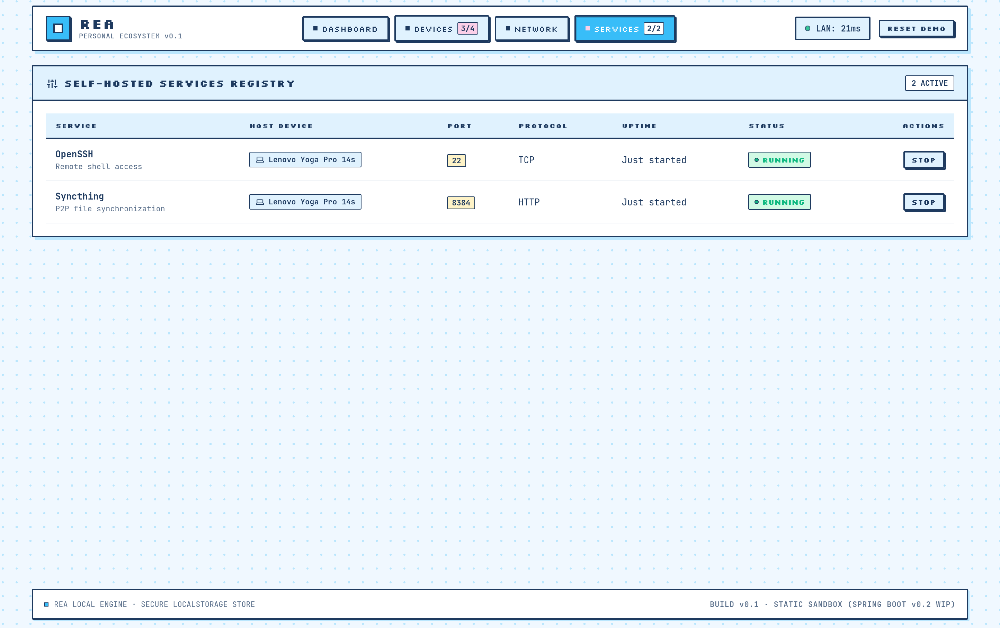

# REA — Personal Device Ecosystem

A lightweight, tactile pixel-inspired monitoring dashboard for tracking personal devices, local network topology, and self-hosted services across a home lab.


---

## Interface Preview



<details>
<summary><strong>View Additional Modules (Devices, Network Topology & Services)</strong></summary>

<br>

**Device Registry & Telemetry**


**LAN Block-Tree Topology**


**Self-Hosted Services Manager**


</details>

---

## Core Capabilities (`v0.1.0`)

- **Telemetry Dashboard:** Live KPI summary tracking online nodes, gateway latency, active service ports, quick device statuses, and a chronological event feed.
- **Device Registry (CRUD):** Real-time search (by hostname, OS, or IPv4), status filtering (`ALL` / `ONLINE` / `OFFLINE`), one-click state toggling, and hardware registration via a validated modal form.
- **Visual Block-Tree Topology:** Dynamic CSS/DOM node tree mapping the local gateway router to connected subnet leaves with interactive latency re-testing.
- **Services Registry:** Tracks self-hosted daemons (e.g., OpenSSH, Syncthing), host bindings, ports, protocols, and uptime with interactive `START` / `STOP` controls.
- **Persistent Sandbox State:** Backed by Web Storage (`localStorage`) with one-click reset to seeded lab data.

---

## Architecture & Design Decisions

- **Zero-Build & Framework-Free:** Built strictly with semantic HTML5, custom-property CSS3, and modular ES6+ JavaScript — zero bundlers, zero runtime overhead, instant cold load.
- **Decoupled Storage Layer (`v0.2`-Ready):** All UI components read and mutate state exclusively through a centralized storage adapter (`getState` / `saveState`). Migrating from `localStorage` (`v0.1`) to a Java Spring Boot + PostgreSQL REST API (`v0.2`) requires replacing only the persistence layer without rewriting DOM renderers.
- **Tactile Pixel Design System:** Combines a high-contrast sky-blue/navy palette with `2px` hard borders, `Silkscreen` display headers, `JetBrains Mono` telemetry metrics, and `Pixelarticons` (`24×24` pixel grid).

---

## Project Structure

```text
rea/
├── index.html          # Multi-panel semantic layout & validated add-device modal
├── style.css           # Tactile grid design tokens, 10-segment meters & topology tree
├── app.js              # Unidirectional state management, event delegation & renderers
└── docs/
    └── screenshots/    # UI captures for documentation
```
